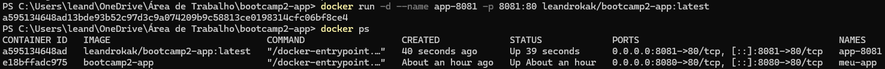

# Weather Reporter

## Autor
Leandro Kenji Assunção Kato — Matrícula 22551460

## Descrição
Um aplicativo de previsão do tempo. Usando a API do Open Meteo o usuário poderá acessar de qualquer lugar o clima atual de qualquer cidade do mundo.

## API utilizada
- Open Meteo e Geocoding 
- https://open-meteo.com/en/docs
- https://open-meteo.com/en/docs/geocoding-api
- Endpoints consumidos: 2

## Funcionalidades
- Digite o nome de uma cidade, o APP completa o nome e especifica país mesmo não escrito perfeitamente
- Uma aba de favoritos, o app tem a opção de salvar cidades com base no seu navegador atual, eles ficaram salvos mesmo após fechar o navegador em um banco de dados no Supabase.

## Persistência de Dados

A aplicação utiliza o **Supabase** como plataforma de backend (BaaS) para o gerenciamento e armazenamento persistente dos dados em um banco de dados relacional **PostgreSQL** hospedado na nuvem.

### Estrutura do Banco de Dados

Os dados salvos pela aplicação estão estruturados no banco de dados com a seguinte organização:

| Coluna | Tipo | Descrição |
| :--- | :--- | :--- |
| `id` | `int8` | Chave primária de identificação do registro (inteiro de 64 bits) |
| `created_at` | `timestamptz` | Data e hora exatas da criação do registro (com fuso horário) |
| `name_city` | `text` | Nome da cidade inserida ou selecionada na aplicação |
| `user_device_id` | `text` | Identificador do dispositivo do usuário |

### O que é salvo?
- O nome da cidade enviada através da interface do usuário (`name_city`).
- O identificador do dispositivo do usuário (`user_device_id`) para associar os registros de cada acesso.
- A data e o momento exatos em que a requisição foi realizada (`created_at`), gerados automaticamente.

## Docker 
- Aplicado usando o docker para utilização remota
- link do repositório docker: "https://hub.docker.com/repository/docker/leandrokak/bootcamp2-app/general"
- Comando para rodar: `docker run -d -p 8081:80 leandrokak/bootcamp2-app:1.0`

### Docker Tags
- O repositório docker atual possui 3 tags:
    1.0 - A versão inicial
    1.1 - Algumas alterações no style.css
    latest - Direta com a 1.1

### Otimização com .dockerignore
Utilizado o arquivo `.dockerignore` para excluir arquivos desnecessários durante a construção da imagem Docker. 
Benefícios:
- Builds mais rápidos: Reduz o tamanho do contexto enviado ao daemon do Docker durante o comando `docker build`.
- Imagens mais leves: Impede a cópia de arquivos temporários e dependências locais para a imagem final, garantindo um container mais enxuto e seguro.

## Orquestração e Escalabilidade com Kubernetes

Gerenciar manualmente centenas de containers diretamente com o Docker Engine torna-se inviável em termos de disponibilidade, balanceamento de carga e manutenção. Para lidar com essa complexidade, utiliza-se um orquestrador como o **Kubernetes (K8s)**. Em um cenário com centenas de instâncias, o Kubernetes gerencia um **Cluster** (um conjunto de máquinas físicas ou virtuais) onde as aplicações são implantadas. Em vez de lidar com os containers individualmente, a aplicação é empacotada em **Pods** (a menor unidade implantável, que contém um ou mais containers). Através do conceito de **Réplicas** e do recurso de *Deployment*, basta declarar a quantidade desejada de instâncias para que o cluster distribua a carga de trabalho automaticamente, realize o *self-healing* (substituindo Pods com falha) e garanta que todas as réplicas permaneçam ativas e acessíveis sem intervenção manual.

### Simulação: Containers Simultâneos

## Como executar localmente
1. Clone: `git clone https://github.com/LeandroKAK/bootcamp2-app`
2. Abra o arquivo `index.html`

## Links
- **Aplicação no ar (GitHub Pages):** https://leandrokak.github.io/bootcamp2-app/
- **Repositório GitHub:** https://github.com/LeandroKAK/bootcamp2-app
- **Repositório Docker:** https://hub.docker.com/repository/docker/leandrokak/bootcamp2-app